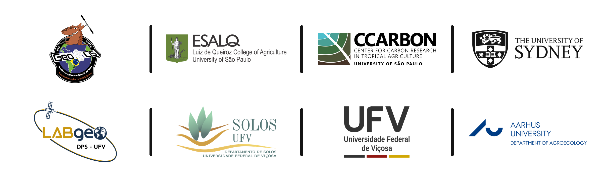
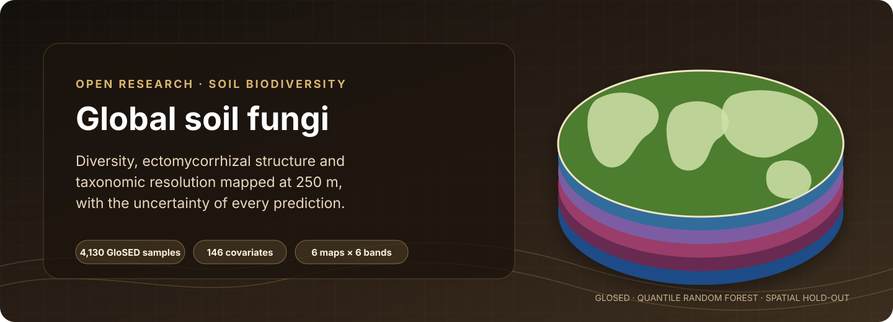
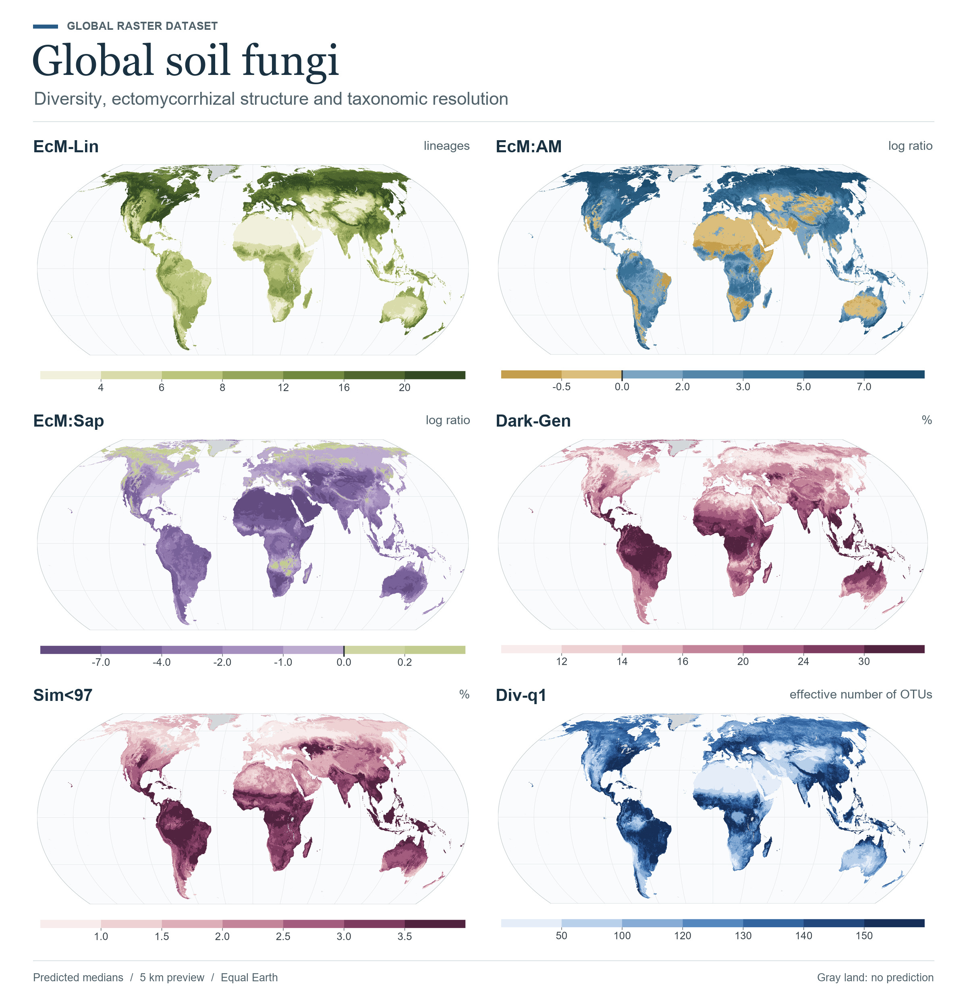
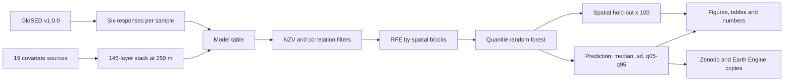

<p align="center">
  
</p>

<p align="center">
  
</p>

<p align="center">
  <a href="https://doi.org/10.5281/zenodo.24292559"></a>
  <a href="https://doi.org/10.5281/zenodo.17827890"></a>
  
  
</p>

<p align="center">
  <a href="https://github.com/moquedace/global_soil_fungi/actions/workflows/validate.yml"></a>
  <a href="LICENSE"></a>
  <a href="https://creativecommons.org/licenses/by/4.0/"></a>
</p>

<p align="center">
  <a href="#paper-first">Paper</a> &#183;
  <a href="#at-a-glance">At a glance</a> &#183;
  <a href="#workflow">Workflow</a> &#183;
  <a href="#quick-start">Quick start</a> &#183;
  <a href="#code-map">Code</a> &#183;
  <a href="#data-products">Data products</a> &#183;
  <a href="#scope">Scope</a> &#183;
  <a href="#citation">Citation</a>
</p>

# Soil fungal diversity is greatest where taxonomic knowledge is poorest, not where ectomycorrhizal lineages are richest

This repository contains the curated R and Google Earth Engine workflow behind global maps, at 250 m, of six dimensions of the soil fungal community in the top 5 cm of soil: overall diversity, ectomycorrhizal (EcM) lineage diversity, the balances between EcM and arbuscular mycorrhizal fungi and between EcM and saprotrophic fungi, and two measures of taxonomic resolution. Every map comes with the uncertainty of the prediction in each cell.

> **Canonical sources.** The article is the source of record for the methods and their interpretation. The maps are versioned and preserved on Zenodo and mirrored in Google Earth Engine. This code-only repository documents the computational sequence of the study; it does not redistribute the input data, which are read from their original sources.

## Paper first

**Moquedace, C&aacute;ssio M.; Baldi, Clara G. O.; Gomes, Lucas C.; Siqueira, Rafael G.; Xue, Peipei; Minasny, Budiman; Schaefer, Carlos Ernesto G. R.; Francelino, M&aacute;rcio R.; Cerri, Carlos Eduardo P.; Poppiel, Ra&uacute;l R.; Pelegrino, Marcelo H. P.; Soares, Lucas U. L.; Dematt&ecirc;, Jos&eacute; A. M.; Fernandes-Filho, Elp&iacute;dio I.** Soil fungal diversity is greatest where taxonomic knowledge is poorest, not where ectomycorrhizal lineages are richest. *Manuscript under review; the reference will be added on publication.*

The six dimensions follow three different geographies. Overall diversity is highest in the humid tropics, where the share of reads without a genus is also largest; EcM lineage diversity and the representation of EcM fungi are highest in temperate and boreal ecosystems; and high values of overall diversity and EcM lineage diversity coincide no more often than expected by chance.

<p align="center">
  
</p>

## At a glance

| Dimension | Design |
|---|---|
| Samples | 4,130 topsoil samples (0-5 cm) of GloSED v1.0.0, full-length ITS by long-read sequencing |
| Responses | Div-q1 (Hill number of order 1), EcM-Lin (EcM lineages), EcM:AM and EcM:Sap (natural log ratios), Dark-Gen and Sim<97 (% of fungal reads) |
| Predictors | 146 layers from 19 sources, grouped by SCORPAN factor (climate, organisms, relief, soil, parent material) |
| Grid | 250 m in the equal-area Equal Earth projection (EPSG:8857), north of 60 S |
| Model | Quantile random forest (500 trees), predictors selected by recursive feature elimination |
| Validation | Spatial hold-out with 2 x 2 degree blocks, repeated 100 times; declustering weights for the metrics |
| Performance | Median Nash-Sutcliffe efficiency 0.12 (Div-q1) to 0.48 (EcM-Lin); 90% intervals within 3.6 percentage points of nominal coverage |
| Uncertainty | Median, standard deviation and the 5, 25, 75 and 95% quantiles of the predictive distribution in every cell |

## Workflow



The correspondence between the article and the scripts, the data sources and the software versions are in [Methods and code](docs/methods_and_code.md).

## Quick start

Install the packages listed in [`DESCRIPTION`](DESCRIPTION), set the project root and the number of cores, and run the scripts of each stage in numerical order:

```r
options(soil_fungi.root = "path/to/global_soil_fungi", soil_fungi.cores = 8)

source("scripts/01_covariates/01_download_sources.R")  # then 02 to 05
source("scripts/02_responses/01_download_glosed.R")     # then 02 to 04
source("scripts/03_modeling/01_extract_covariates.R")   # then 02 and 03
source("scripts/04_prediction/01_predict_tiles.R")      # then 02
source("scripts/05_figures_tables/01_figure1_samples_biomes.R")  # then 02 to 11
```

The model fitting and the spatial hold-out are heavy (days on a single machine); the article ran them on a SLURM cluster with the job in [`hpc/`](hpc/README.md). Some sources need a manual download or an Earth Engine export first: see [Methods and code](docs/methods_and_code.md#input-data).

## Code map

```text
.
|-- .github/workflows/        # syntax, links and citation checks
|-- assets/                   # banner and map preview
|-- docs/methods_and_code.md  # article -> scripts, data sources, software
|-- hpc/                      # generic SLURM job for the heavy steps
|-- scripts/
|   |-- 00_config.R           # project root, folders, grid, responses, protocol
|   |-- functions/            # model, RFE, metrics and figure helpers
|   |-- 01_covariates/        # sources, grid and domain, fractions, resampling, gaps, stack (+ gee/)
|   |-- 02_responses/         # GloSED download, genus traits, six responses, rarefaction test
|   |-- 03_modeling/          # extraction, final model, spatial hold-out
|   |-- 04_prediction/        # tiled prediction and mosaics
|   |-- 05_figures_tables/    # Figures 1-8 and S1, Tables S1-S2, numbers in the text
|   `-- 06_distribution/      # integer copies for Zenodo and Earth Engine (+ gee/)
|-- tools/                    # documentation checks
|-- .zenodo.json
|-- CITATION.cff
|-- DESCRIPTION
|-- LICENSE
`-- README.md
```

## Data products

The maps are on Zenodo ([10.5281/zenodo.24292559](https://doi.org/10.5281/zenodo.24292559)): one Cloud Optimized GeoTIFF per dimension, six bands (median, sd, q05, q25, q75, q95), 250 m in Equal Earth (EPSG:8857), 16-bit integers with the scale factor in the metadata. The record's README describes the files, units and how to read them.

The same maps are public Google Earth Engine assets in geographic coordinates, one ImageCollection per dimension:

```javascript
var root = 'projects/ee-cassiomoquedace/assets/soil_fungi/';
var scale = {ecm_lin: 0.1, ecm_am: 0.01, ecm_sap: 0.01, dark_gen: 0.01, sim_below97: 0.01, div_q1: 0.1};
var div_q1 = ee.ImageCollection(root + 'div_q1').mosaic()
  .rename(['median', 'sd', 'q05', 'q25', 'q75', 'q95'])
  .multiply(scale.div_q1);
Map.addLayer(div_q1.select('median'), {min: 0, max: 220}, 'Div-q1 median (effective OTUs)');
```

## Scope

The release separates three layers:

1. **Article:** methods, results and interpretation.
2. **GitHub:** curated code in the order of the published workflow.
3. **Zenodo and Earth Engine:** the citable maps.

The scripts keep the published protocol and drop what served only the working environment (logs, network retries, pilot runs, exploratory scripts). They show the computational sequence and where the data enter, but they are not a one-command reproduction: the inputs are large, several need a manual download, and the heavy steps need a cluster.

## Citation

If you use the code, cite the article and the map dataset. Machine-readable metadata are in [`CITATION.cff`](CITATION.cff).

> Moquedace, C. M., et al. Global maps of soil fungal diversity, ectomycorrhizal structure and taxonomic resolution at 250 m [Data set]. Zenodo. https://doi.org/10.5281/zenodo.24292559

The fungal data come from GloSED: Mikryukov, V., et al. (2026). Global dataset of soil eukaryotic communities created with a uniform protocol and long read sequencing. *Scientific Data*. https://doi.org/10.1038/s41597-026-07315-y

## License

The code is released under the [MIT License](LICENSE). The maps on Zenodo are licensed CC BY 4.0. The MIT License does not cover the input data, which keep the licenses of their sources.

## Contact

For questions about the code or the maps, use the corresponding-author details in the article or open a GitHub issue naming the script, the input and the error.
